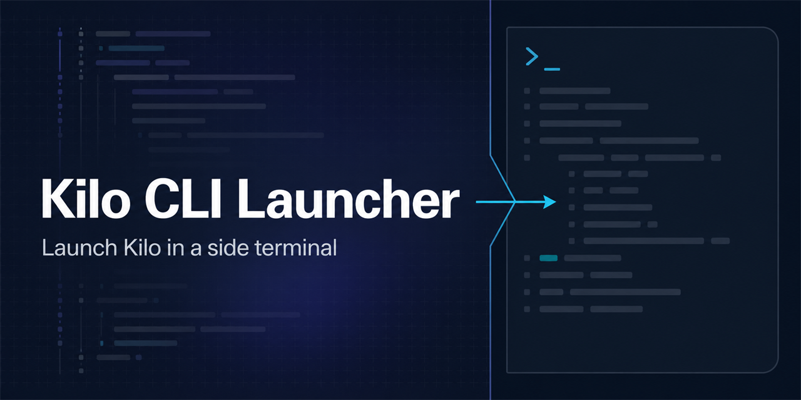

# Kilo CLI Launcher

Launch Kilo CLI in a fresh side terminal directly from the editor toolbar

[](https://github.com/TheStreamCode/vscode-kilo-cli-launcher/actions/workflows/ci.yml)
[](LICENSE)
[](https://marketplace.visualstudio.com/items?itemName=mikesoft.vscode-kilo-cli-launcher)



Kilo CLI Launcher is an unofficial VS Code extension for Windows, macOS, and Linux. It stays deliberately small: one click, one new terminal, no telemetry or background services. It uses the active editor workspace when available, with a fallback to the first open workspace folder.

> **Disclaimer.** This extension is unofficial and is not affiliated with, endorsed by, or sponsored by Kilo or KiloCode. Kilo-related names are used only to identify the compatible CLI. See [`TRADEMARKS.md`](TRADEMARKS.md).

## Install

Install from the [Visual Studio Marketplace](https://marketplace.visualstudio.com/items?itemName=mikesoft.vscode-kilo-cli-launcher) or from [Open VSX](https://open-vsx.org/extension/mikesoft/vscode-kilo-cli-launcher), or download the latest VSIX from [GitHub releases](https://github.com/TheStreamCode/vscode-kilo-cli-launcher/releases/latest).

VS Code users can install the Marketplace build from a terminal:

```bash
code --install-extension mikesoft.vscode-kilo-cli-launcher
```

Kilo CLI itself is a separate product. Install it from the [official Kilo CLI documentation](https://kilo.ai/docs/code-with-ai/platforms/cli) and confirm that `kilo` works in an integrated terminal.

## Quick start

1. Install Kilo CLI and make sure `kilo` runs in your integrated terminal.
2. Install this extension and open a trusted workspace.
3. Click the Kilo launcher button in the editor title bar.

Each launch creates a new terminal beside the current editor and sends the configured command immediately. Existing terminals are not reused.

## Features

- Launcher button in the editor title area
- A fresh terminal beside the active editor on every launch
- Active-editor workspace selection with multi-root fallback
- Configurable Kilo CLI command and terminal label
- Installation decisions stay with the user, with a link to the official Kilo CLI documentation
- Quoted Windows executable-path support
- Custom launch commands, such as `npx --yes @kilocode/cli`
- No telemetry, analytics, or personal data collection

## Requirements

- VS Code `^1.103.0`
- Kilo CLI available in the integrated terminal environment, or a working custom launch command in settings

## Configuration

| Setting | Purpose | Default |
| --- | --- | --- |
| `kilocodeCliLauncher.cliCommand` | Command sent to the new terminal. Machine-scoped; workspace values are ignored. | `kilo` |
| `kilocodeCliLauncher.terminalName` | Base label for new terminals. | `Kilo CLI` |

For security, `cliCommand` is read only from the user-level machine setting or its default. Workspace and workspace-folder overrides are ignored, so a cloned repository cannot replace the command launched from the toolbar. `terminalName` remains a window-scoped presentation setting.

Open the settings with **Kilo CLI launcher: Open Settings** from the Command Palette.

Launch through `npx`:

```json
"kilocodeCliLauncher.cliCommand": "npx --yes @kilocode/cli"
```

Windows executable path with spaces:

```json
"kilocodeCliLauncher.cliCommand": "\"C:\\Program Files\\Kilo CLI\\kilo.cmd\""
```

The extension requires no runtime environment variables and does not load `.env` files. Kilo CLI itself may use its own environment or authentication configuration; follow the official Kilo documentation for those requirements.

## Privacy and security

Kilo CLI Launcher does not collect telemetry, analytics, or personal data.

Launching is available only in trusted workspaces. The launcher runs the configured command only in VS Code's integrated terminal; review the workspace and command before you trust or launch it. The extension does not install Kilo CLI, create installer scripts, inspect shell execution, or access the network. If `kilo` is unavailable, use the terminal error and open the [official Kilo CLI documentation](https://kilo.ai/docs/code-with-ai/platforms/cli) to choose and run an installation method yourself.

See [`SECURITY.md`](SECURITY.md) for private vulnerability reporting.

## Troubleshooting

### The terminal opens but `kilo` is not recognized

Follow the [official Kilo CLI documentation](https://kilo.ai/docs/code-with-ai/platforms/cli), then confirm that `kilo` works in a regular integrated terminal. If your setup relies on shell initialization, restart VS Code after installation.

### Nothing happens after clicking the button

Check `kilocodeCliLauncher.cliCommand` and verify that the same command works in a regular terminal. Confirm that the workspace is trusted.

### Custom executable path on Windows

Quote executable paths that contain spaces, for example `"C:\Program Files\Kilo CLI\kilo.cmd"`.

### Multi-root workspaces

The launcher prefers the workspace folder of the active editor. To control where Kilo starts in a multi-root window, open a file from the target workspace before clicking the toolbar button.

## Development

Requirements: Node.js 22 and npm with the committed `package-lock.json`.

```bash
git clone https://github.com/TheStreamCode/vscode-kilo-cli-launcher.git
cd vscode-kilo-cli-launcher
npm ci
npm run typecheck
npm run check
```

`npm run check` runs the strict type check, all unit and metadata tests, the VS Code extension-host smoke test, and the VSIX content inspection. `npm run package` builds a local `.vsix`. Set `VSCODE_VERSION` to a specific editor version for the integration test; it defaults to the minimum supported version, and CI also tests the current stable release.

The runtime intentionally has two small modules. `src/extension.ts` connects VS Code commands, Workspace Trust, settings, and terminal creation; `src/command-utils.ts` contains pure normalization and workspace-resolution helpers covered by Node unit tests. The extension has no production npm dependencies, background services, network client, telemetry, or persistent storage.

## Support

Open a [GitHub issue](https://github.com/TheStreamCode/vscode-kilo-cli-launcher/issues) for bugs and feature requests, or read [`SUPPORT.md`](SUPPORT.md) for the information to include. Maintenance can be supported through [GitHub Sponsors](https://github.com/sponsors/TheStreamCode).

Need one launcher for every agent? [Super CLI](https://marketplace.visualstudio.com/items?itemName=mikesoft.vscode-super-cli) is a single sidebar for Claude Code, Codex, Copilot, Cursor, Grok, Kilo, Antigravity, OpenCode, and more.

## Contributing

See [`CONTRIBUTING.md`](CONTRIBUTING.md). Pull requests must pass the required CI checks.

## License

MIT License — see [`LICENSE`](LICENSE).

---

Maintained by [Michael Gasperini (Mikesoft)](https://mikesoft.it).
If this project is useful to you, consider [sponsoring its maintenance](https://github.com/sponsors/TheStreamCode).
